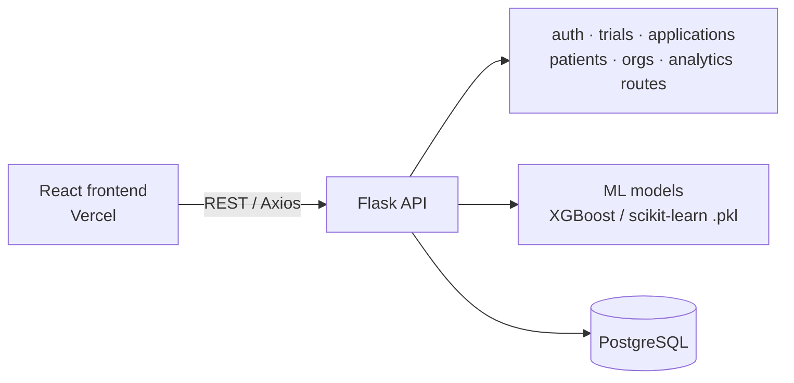

# Virtual Patient Recruitment System

A full-stack platform that helps clinical trial teams find eligible patients faster. Organizations publish trials, patients apply through dynamic forms, and machine-learning models screen eligibility automatically — one application at a time or in bulk from CSV/Excel — with an analytics dashboard on top.

**Live demo:** https://virtual-patient-recruitment-7kn6.vercel.app/login


---

## Why it matters

Patient recruitment is one of the most common reasons clinical trials are delayed. Manually checking each applicant against eligibility criteria is slow and inconsistent. This project automates the first-pass screening so coordinators can focus on the candidates most likely to qualify.

## Features

- **Role-based access** — separate flows for patients, organizations and admins, with hashed passwords (bcrypt).
- **Patient applications** — dynamic forms per trial.
- **ML eligibility screening** — four trained models (XGBoost / scikit-learn) score applicants for hypertension, arthritis, migraine and Phase 1 trials through real-time inference APIs.
- **Bulk screening** — upload a CSV/Excel file and screen many patients in one request.
- **Analytics dashboard** — application volumes, eligibility rates and per-trial statistics.

## Architecture



## Tech stack

| Layer | Tools |
|---|---|
| Frontend | React, React Router, Recharts, Axios, react-hot-toast |
| Backend | Python, Flask, Flask-Bcrypt, Flask-CORS, Gunicorn |
| ML | XGBoost, scikit-learn, pandas, NumPy, joblib |
| Database | PostgreSQL (psycopg2) |
| Deployment | Vercel (frontend), Render/Railway (API) |

## Project structure

```
backend/
  app.py              # Flask entry point
  config.py           # DB config and model paths (read from env vars)
  database/           # schema.sql, setup_db.py
  ml_models/          # trained models (*.pkl)
  models/             # model loading and inference
  routes/             # admin, analytics, applications, auth, org, patient, trial
  utils/              # DB connection and helpers
frontend/
  src/                # App, components, services (API calls), styles
```

## Run locally

**Backend**

```bash
cd backend
pip install -r requirements.txt
# PostgreSQL connection: either DATABASE_URL, or the individual variables below
export DB_HOST=localhost DB_NAME=virtual_patient_recruitment DB_USER=postgres DB_PASSWORD=<your-password> DB_PORT=5432
python database/setup_db.py
python app.py
```

**Frontend**

```bash
cd frontend
npm install
npm start
```

## Roadmap

- Report model accuracy, precision and recall per trial model in this README
- Serve models with FastAPI and track experiments in MLflow
- Containerize with Docker and add CI tests

## Author

**Anjali Sinkar** — [Portfolio](https://anjali-portfolio-six-beige.vercel.app/) · [LinkedIn](https://www.linkedin.com/in/anjali-sinkar-97728925a) · [GitHub](https://github.com/Anjali-Sinkar)
